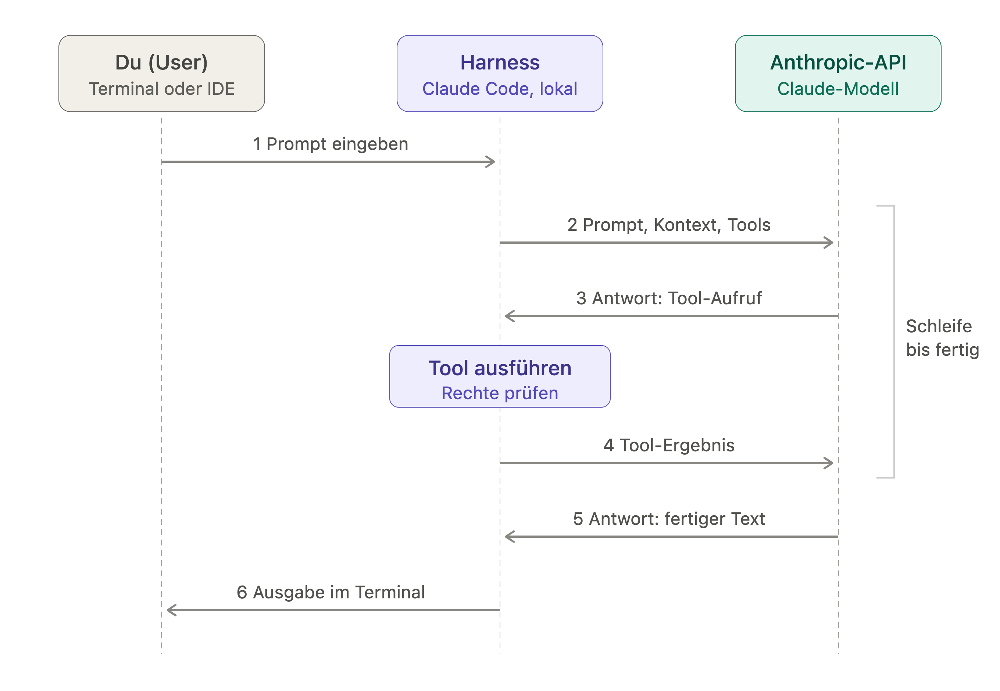

# Livecall 16.11.2026: Tools und Slash-Commands in Claude Code

## Worum ging es?

Aufbau des **Grundverständnisses für KI-Agenten**: Wir haben den **Harness** von Claude Code kennengelernt und dabei das Konzept der **Tool-Calls** getestet. Außerdem standen die grundlegenden **Slash-Commands** auf dem Programm.

## Was wir gemacht haben

1. **Tools getestet:**
   - **read, edit, write:** Datei-Inhalt zusammengefasst, die README erweitert, eine neue Datei erstellt.
   - **search:** Alle `.service`-Dateien gezählt.
   - **web-search:** Den ersten Satz aus einem Abschnitt der Doku ausgelesen.
   - **bash:** Commits aufgelistet, einen Commit erstellt, einen Server gestartet.
2. **Basis-Befehle kennengelernt:** `/model`, `/effort`, `/usage`, `/context`, `/clear` und `/resume`.

## Links

| Thema | Link |
|---|---|
| Wie Claude Code funktioniert (Tools) | https://code.claude.com/docs/en/how-claude-code-works#tools |
| Tools-Referenz | https://code.claude.com/docs/en/tools-reference |
| Befehle | https://code.claude.com/docs/en/commands |

## So kannst du es nachmachen

1. Lies den Abschnitt zu den [Tools](https://code.claude.com/docs/en/how-claude-code-works#tools) und wirf einen Blick in die [Tools-Referenz](https://code.claude.com/docs/en/tools-reference).
2. Gib Claude Code in einem eigenen Projekt kleine Aufgaben, die je ein Tool nutzen, zum Beispiel eine Datei zusammenfassen oder Commits auflisten.
3. Probiere die [Basis-Befehle](https://code.claude.com/docs/en/commands) selbst aus.
